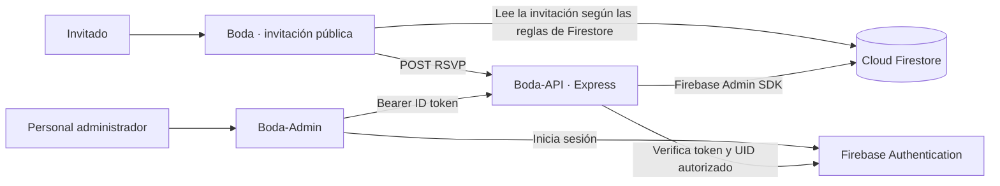

# Boda-API

API HTTP de la plataforma Boda. Centraliza las reglas de negocio y las escrituras de invitaciones y respuestas RSVP en Firestore. La API también ofrece operaciones administrativas protegidas para Boda-Admin.

## 1. Responsabilidad

Boda-API conecta la invitación pública y el panel administrativo con los datos de la boda. Valida las solicitudes, aplica las reglas de RSVP e invitaciones y persiste las operaciones en Firestore. Las rutas administrativas requieren autenticación; guardar un RSVP es una operación pública sujeta a las validaciones del dominio.

## 2. Arquitectura



- **Boda** muestra la invitación pública, consulta la invitación en Firestore y envía las respuestas RSVP a la API.
- **Boda-Admin** gestiona invitaciones y métricas; autentica al administrador con Firebase Authentication y llama a las rutas protegidas.
- **Boda-API** valida ambas clases de operación y accede a Firestore mediante Firebase Admin SDK.

Los tres proyectos y su flujo integrado de emuladores se describen también en `Boda/docs/local-emulator.md` cuando los repositorios están instalados como carpetas hermanas.

## 3. Tecnologías

- Node.js `24.x` y TypeScript.
- Express 5 para HTTP y `cors` para permitir los orígenes configurados.
- Firebase Admin SDK para verificar tokens de Firebase Authentication y acceder a Cloud Firestore.
- `dotenv` para cargar configuración local, `tsx` para desarrollo y Vitest para pruebas.
- Swagger UI y OpenAPI para consultar el contrato HTTP.

Las dependencias y scripts vigentes están declarados en `package.json`.

## 4. Rutas HTTP

Todas las rutas de la API se montan bajo `/api`. La especificación OpenAPI está disponible en `GET /api/openapi.json` y su interfaz en `/api/docs`.

| Método | Ruta | Autorización | Uso |
|---|---|---|---|
| `GET` | `/api/health` | Pública | Estado del servicio. |
| `GET` | `/api/openapi.json` | Pública | Especificación OpenAPI. |
| `GET` | `/api/docs` | Pública | Interfaz Swagger UI. |
| `GET` | `/api/admin/health` | Administrador | Estado del servicio con autenticación. |
| `POST` | `/api/public/invitations/:id/rsvp` | Pública | Guardar el RSVP de una invitación. |
| `GET` | `/api/admin/invitations` | Administrador | Listar invitaciones. Acepta `search`, `rsvpStatus`, `archived`, `page` y `pageSize`. |
| `POST` | `/api/admin/invitations` | Administrador | Crear una invitación. Acepta `Idempotency-Key` opcional. |
| `GET` | `/api/admin/invitations/:id` | Administrador | Consultar una invitación. |
| `PATCH` | `/api/admin/invitations/:id` | Administrador | Editar campos administrativos permitidos. Cambiar `editOverrideUntil` requiere `X-Invitation-Version`. |
| `PATCH` | `/api/admin/invitations/:id/capacity` | Administrador | Cambiar la capacidad. |
| `PATCH` | `/api/admin/invitations/:id/guests/:guestIndex` | Administrador | Corregir el nombre de un invitado; requiere `X-Invitation-Version`. |
| `POST` | `/api/admin/invitations/:id/guests/:guestIndex/remove` | Administrador | Eliminar un invitado permitido y reducir la capacidad; requiere `X-Invitation-Version`. |
| `POST` | `/api/admin/invitations/:id/guests/:guestIndex/restore-replacement` | Administrador | Restaurar al invitado original; requiere `X-Invitation-Version`. |
| `POST` | `/api/admin/invitations/:id/archive` | Administrador | Archivar una invitación. |
| `POST` | `/api/admin/invitations/:id/restore` | Administrador | Restaurar una invitación archivada. |

Las rutas administrativas usan `Authorization: Bearer <Firebase ID token>`. El endpoint RSVP no requiere ese token; valida el contenido, la invitación y el estado esperado antes de guardar. Las reglas completas de cuerpos, respuestas y errores se publican en OpenAPI.

## 5. Autenticación y validaciones de seguridad

- `authenticateAdmin` verifica el Firebase ID token con Firebase Admin SDK y permite el acceso solo si el UID aparece en `ADMIN_FIREBASE_UIDS`. El código no define roles administrativos adicionales.
- `CORS_ALLOWED_ORIGINS` define orígenes HTTP(S) exactos. CORS controla el acceso desde navegadores y no sustituye la autenticación de las rutas administrativas.
- Express limita los cuerpos JSON a `100kb`; los errores de JSON inválido o demasiado grande se responden sin exponer errores internos.
- Los validadores rechazan campos no permitidos, identificadores e índices inválidos, estados RSVP fuera del enum y capacidades no válidas.
- Las operaciones sensibles a concurrencia comprueban `X-Invitation-Version`. El RSVP compara `expectedState` con el estado vigente para detectar formularios obsoletos.
- La clave `Idempotency-Key` permite reintentar de forma idempotente la creación cuando el cliente la proporciona.
- El RSVP respeta el cierre definido en `src/services/publicRsvp.service.ts`, el archivado y los permisos extraordinarios válidos.

## 6. Firebase Admin SDK y Firestore

`src/config/firebaseAdmin.ts` inicializa Firebase Admin y expone Auth y Firestore a los servicios. Fuera del modo emulador, la inicialización usa Application Default Credentials (ADC) y `FIREBASE_PROJECT_ID`; las credenciales deben ser proporcionadas de forma segura por el entorno de ejecución y nunca guardarse en el repositorio.

Los servicios operan principalmente sobre la colección `invitations`. Las escrituras de RSVP, cambios de capacidad, archivo, eliminación/restauración de invitados y operaciones idempotentes usan transacciones cuando necesitan comprobar y actualizar un estado consistente. La creación idempotente conserva recibos internos para reconocer reintentos. El índice de búsqueda se guarda junto a la invitación.

Firebase Admin accede a Firestore con la identidad de servicio configurada para el backend; las reglas de seguridad de Firestore no reemplazan los controles de acceso de la API. Boda, que usa Firebase Web SDK para lecturas públicas, está sujeto a las reglas del cliente.

## 7. Variables de entorno

`.env.example` muestra los nombres de configuración no secreta. `.env` está excluido de Git. No incluyas tokens, claves privadas ni credenciales en este README ni en archivos versionados.

| Variable | Requisito y uso |
|---|---|
| `PORT` | Opcional; puerto HTTP. Predeterminado: `3000`. Debe ser un entero entre `1` y `65535`. |
| `FIREBASE_PROJECT_ID` | Obligatoria; proyecto de Firebase para Firebase Admin. En modo emulador debe ser exactamente `demo-boda`. |
| `ADMIN_FIREBASE_UIDS` | Obligatoria; lista separada por comas de UID autorizados para las rutas administrativas. |
| `CORS_ALLOWED_ORIGINS` | Lista separada por comas de orígenes exactos `http://` o `https://` permitidos. |
| `USE_FIREBASE_EMULATORS` | Opcional; acepta `true` o `false` y por defecto es `false`. |
| `NODE_ENV` | En modo emulador debe ser `development`. |
| `FIRESTORE_EMULATOR_HOST` | Obligatoria en modo emulador; la configuración validada es `127.0.0.1:8080`. |
| `FIREBASE_AUTH_EMULATOR_HOST` | Obligatoria en modo emulador; la configuración validada es `127.0.0.1:9099`. |

Si no se configura `CORS_ALLOWED_ORIGINS`, no se permite ningún origen de navegador; las solicitudes sin encabezado `Origin` siguen el comportamiento del middleware CORS. `NODE_ENV` no se necesita para activar la conexión normal a Firebase.

## 8. Instalación y ejecución local

Requisitos: Node.js `24.x` y npm. Configura `FIREBASE_PROJECT_ID`, al menos un UID en `ADMIN_FIREBASE_UIDS` y los orígenes de desarrollo en `CORS_ALLOWED_ORIGINS`. Para Firebase normal, configura ADC en el entorno de ejecución. Para desarrollo aislado, sigue la sección de emuladores.

```powershell
npm ci
npm run dev
```

`npm run dev` ejecuta `tsx watch src/server.ts`. La API usa el puerto `3000` por defecto. `npm start` inicia el JavaScript compilado y se documenta en la sección de build.

## 9. Firebase Emulator Suite

El modo emulador está sujeto a comprobaciones estrictas: requiere `NODE_ENV=development`, `USE_FIREBASE_EMULATORS=true`, proyecto `demo-boda` y ambos hosts locales exactos. En ese modo la API no configura ADC y escucha solo en `127.0.0.1`. Si alguna condición no coincide, la configuración falla al iniciar.

1. Con los tres repositorios disponibles, inicia Auth y Firestore Emulator desde la raíz de **Boda**, siguiendo `docs/local-emulator.md`:

   ```powershell
   npm exec -- firebase emulators:start --only auth,firestore --project demo-boda
   ```

2. Inicia sesión localmente desde Boda-Admin contra Auth Emulator y obtén el UID creado allí. No uses un UID de una cuenta real.

3. En otra terminal, configura Boda-API y arráncala:

   ```powershell
   Set-Location ..\Boda-API
   $env:NODE_ENV = 'development'
   $env:USE_FIREBASE_EMULATORS = 'true'
   $env:FIREBASE_PROJECT_ID = 'demo-boda'
   $env:FIRESTORE_EMULATOR_HOST = '127.0.0.1:8080'
   $env:FIREBASE_AUTH_EMULATOR_HOST = '127.0.0.1:9099'
   $env:ADMIN_FIREBASE_UIDS = 'UID_LOCAL_DEL_EMULADOR'
   $env:CORS_ALLOWED_ORIGINS = 'http://127.0.0.1:5173,http://127.0.0.1:5174'
   $env:PORT = '3000'
   npm run dev
   ```

Las variables `$env:` solo afectan a esa terminal. Los puertos y el proyecto deben coincidir con los emuladores y clientes locales. La guía integrada en Boda documenta cómo arrancar también Boda y Boda-Admin. Esta configuración no se conecta a un proyecto Firebase real.

## 10. Pruebas y Playwright

```powershell
npm test
```

`npm test` ejecuta Vitest. El conjunto incluye pruebas unitarias de validadores y servicios, y pruebas HTTP que levantan Express en un puerto local y simulan las dependencias externas. No se requiere Firestore real para la suite automatizada de API.

Los recorridos E2E de Playwright viven en el repositorio **Boda**, bajo `scripts/e2e/`, no en Boda-API. Boda ofrece `npm run test:e2e`; sus pruebas cubren flujos integrados de invitaciones y RSVP y requieren Boda, Boda-Admin, Boda-API y Auth/Firestore Emulator configurados según `Boda/docs/local-emulator.md`. Playwright usa Chromium o Chrome local.

Hay scripts operativos auxiliares en `scripts/`: `test:firestore-read` realiza lecturas de invitaciones con la configuración Firebase activa, y `backfill:invitation-search` ofrece modos de simulación y escritura. No forman parte de `npm test`; el backfill en modo de escritura modifica Firestore. Verifica siempre que el destino sea el emulador antes de usar herramientas que lean o escriban datos.

## 11. Estructura principal

```text
src/
├── config/        # Variables de entorno y Firebase Admin
├── controllers/   # Adaptación HTTP de las solicitudes y respuestas
├── errors/        # Errores de dominio, integridad y HTTP
├── http/          # Respuestas HTTP de error
├── middlewares/   # CORS, autenticación y manejo de errores
├── routes/        # Rutas públicas, administrativas y documentación
├── services/      # RSVP, invitaciones, búsqueda, versiones e idempotencia
├── types/         # Tipos de dominio y Express
└── validation/    # Validadores de cuerpos, rutas y consultas
scripts/           # Utilidades operativas de Firestore
tests/             # Pruebas de servicios, validación y HTTP
docs/              # Documentación técnica específica
```

## 12. Build, CI y despliegue

```powershell
npm run build
npm start
```

`npm run build` ejecuta `tsc` y genera `dist/`; `npm start` ejecuta `dist/server.js`. La API requiere las variables de entorno y ADC descritas arriba para conectarse a Firebase fuera del emulador.

`.github/workflows/ci.yml` define CI para `main`: usa Node.js 24, ejecuta `npm ci`, `npm test` y `npm run build` en pushes y pull requests. El repositorio no contiene un destino de hosting, configuración de infraestructura ni script de despliegue; por ello, aquí solo se documentan compilación y arranque verificados.

No hay un script `lint` en `package.json`.

## 13. Fase 1 y limitaciones conocidas

Boda-API implementa las rutas públicas de RSVP y los flujos administrativos de invitaciones: creación, consulta, listado con búsqueda/filtros/paginación, edición de campos permitidos, capacidad, gestión de invitados, archivo y restauración. Las pruebas del repositorio cubren sus validaciones y contratos HTTP; los recorridos de navegador se mantienen en Boda.

Limitaciones verificables del repositorio:

- La autenticación administrativa se basa en una lista de UID configurada, sin un modelo de roles más granular.
- Los E2E integrados requieren los tres repositorios y Firebase Emulator Suite; no se ejecutan con `npm test` en Boda-API.
- No hay script de lint ni instrucciones de despliegue específicas del proveedor.
- El modo emulador de la API contempla Auth y Firestore en loopback; no configura emuladores para otros servicios Firebase.
- Los scripts operativos de lectura y backfill pueden usar el proyecto indicado por la configuración Firebase activa, por lo que deben ejecutarse únicamente tras verificar el destino.
